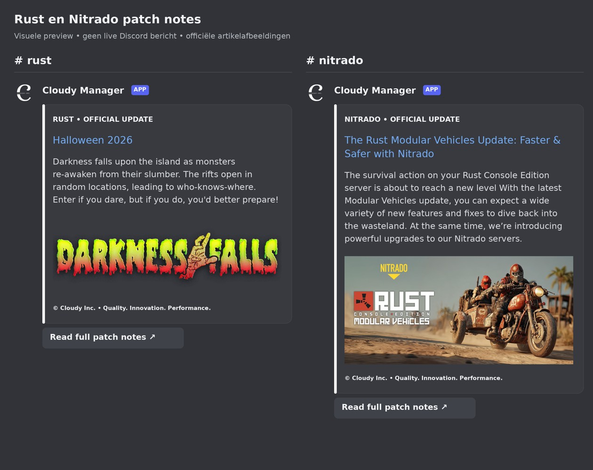

# Rust and Nitrado patch note banners

Preview for the proposed banner fix. This is a visual mockup using the official article images, not a live Discord screenshot. Existing titles, text, logos, colours, footer, components and unrelated attachments are preserved when filling a missing banner.

## Destinations and exact existing-message preview

In `#rust`, the existing **Halloween 2026** embed gains the official `Darkness Falls` image from the same Facepunch article. Its existing message ID and text remain intact. Per user instruction, Rust embeds have no thumbnail or author/footer logo icons; the text footer and article banner remain.

> Darkness falls upon the island as monsters re-awaken from their slumber. The rifts open in random locations, leading to who-knows-where. Enter if you dare, but if you do, you'd better prepare!

In `#nitrado`, the existing **The Rust Modular Vehicles Update: Faster & Safer with Nitrado** already has its article banner and remains intact.

> The survival action on your Rust Console Edition server is about to reach a new level With the latest Modular Vehicles update, you can expect a wide variety of new features and fixes to dive back into the wasteland. At the same time, we’re introducing powerful upgrades to our Nitrado servers.

Both retain `© Cloudy Inc. • Quality. Innovation. Performance.` and the `Read full patch notes` link button.

## Source checks on 28 October 2026

- Facepunch RSS: <https://rust.facepunch.com/rss/news>. The Halloween item has no image. Its article also has empty Open Graph and Twitter images, but an `img.hero_patch-branding` is present.
- Rust article: <https://rust.facepunch.com/news/halloween-2026/>.
- Rust image: <https://files.facepunch.com/jen/2026/October/darkness-falls-branding.png>.
- Nitrado official public GraphQL news API selected the Modular Vehicles article, dated 28 August 2025. Its Discord posting date is not its article publication date. No more recent matching Rust server update was returned; the newer DayZ comparison is correctly excluded.
- Nitrado article: <https://server.nitrado.net/en-US/news/the-rust-modular-vehicles-update-faster-safer-with-nitrado>.
- Nitrado image: <https://newsimg.nitrado.net/2025/08/News-1440x680_EN.jpg>.

The production banner preparation code successfully downloaded both source images and created Discord attachments. No live Discord message was posted or edited during validation.

## Behaviour

New updates require a downloadable PNG, JPEG, GIF or WebP image before publishing or marking the article as processed. Missing or failed feed images are recovered from the same article's metadata or hero image. An unavailable image defers the update until a later poll; it does not publish without a banner or substitute an old article. Images are uploaded with the embed to avoid reliance on Discord hotlinking the publisher CDN.

The latest existing matching bot message can receive only its missing image. Repair rereads the message under the same mutation lock used by manual Save and bypasses automatic styling for that edit. Existing banners are preserved. Runtime catalog and saved decoration passes preserve official patch images.

Production deployment and actual Discord rendering remain pending explicit user approval.
